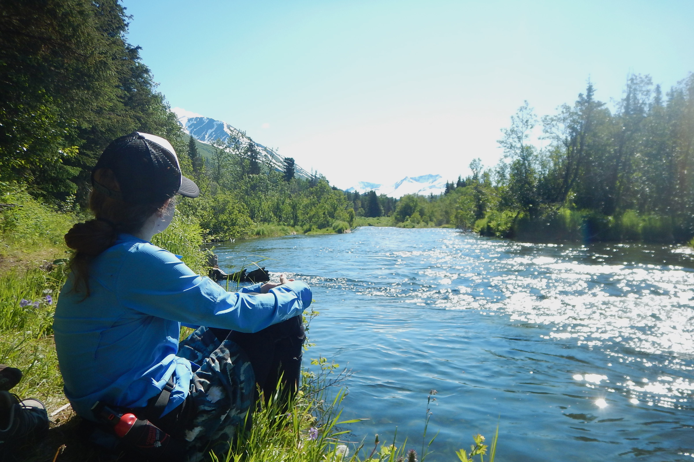

As the climate warms in Alaska, most stream temperatures will also warm. Warmer waters affect how juvenile salmon grow and live, but not all changes are made equal. Will wild salmon be able to handle the kinds of sweeping environmental changes that are coming in the next century? What kind of management actions should we promote in the face of these changes?

I've been involved with several pieces of work that have begun to tackle these questions.

The work spans specialties as diverse as examining fish stomach samples under a microscope to interpreting infrared remote sensing imagery, but share in common a combination of fieldwork alongside modeling efforts to understand changes at the landscape scale.

### University of Alaska Fairbanks M.S. Thesis & Manuscripts (2020)

My M.S. thesis at University of Alaska Fairbanks focused on juvenile salmon growth and diet in the Kenai River watershed in the context of climate change. We found that juvenile Chinook and Coho salmon in warmer, low-elevation streams may see decreased peak summer growth rates as air temperatures increase, whereas juvenile salmon in cooler, higher elevation streams may see a smaller magnitude of change. We also found that managing for healthy riparian habitats helps support the kinds of insects that juvenile coho salmon rely on for food.

#### Publications

- Transactions of the American Fisheries Society ([Meyer et al. 2023](https://www.kenaiwatershed.org/news-media/new-journal-article-by-kwf-staff-climate-change-and-juvenile-salmon-in-the-kenai-river/))

- M.S. Thesis ([Meyer 2020](../../../publications/meyer_2020_ms_thesis/index.qmd))

- Journal of Freshwater Ecology ([Grunblatt et al. 2019](https://www.tandfonline.com/doi/full/10.1080/02705060.2019.1642243))

### USGS Beaver Creek Flow and Temperature Research (2024)

At Kenai Watershed Forum, I worked with collaborators from the U.S. Geological Survey to ask "What's in the Crystal Ball?" for Beaver Creek, a low-elevation, low-gradient tributary of the Kenai River. Beaver Creek is a uniquely interesting local model to tackle questions of freshwater fish habitat in the face of climate and landscape change, because major streamside groundwater wells there serve as the source of drinking water for the City of Kenai. Given the issues of water scarcity facing much of the western United States, we wondered: what could future temperature and flow conditions look like for wild salmon populations here? Will this continue to be a source of drinking water for a growing community?

We used a combination of water temperature and flow monitoring to generate data to support our "Crystal Ball" projections. We found that Beaver Creek summer flow is largely groundwater discharge (64%), and is expected to remain that way through 2050. The City of Kenai wells withdraw about 4% of average base flow. Simulations evaluated a projected small (0.44%) annual increase in municipal pumping through 2050 and found it would have little to no effect on stream temperatures or flow regimes

Stream temperatures are expected to rise; though not all the same throughout the watershed. Areas of high groundwater inflows in the lower main stem and some tributaries may be most resilient to warming air temperatures during dry, warm conditions. During storm events, groundwater-dominated tributaries may have the coolest stream temperatures.

The work again highlights the value of managing for intact riparian areas. As much of Beaver Creek is positioned within the Kenai National Wildlife Preserve, the watershed is currently positioned to remain as a critical resource for both humans and wildlife - as long as we don't take it for granted. The lower watershed lies in patchwork of private and public ownership, which is where landscape stewardship priorities should be targeted.

#### Publications

- USGS Report ([Leaf et al. 2024](https://pubs.usgs.gov/publication/sir20245126/full))

### Thermal Imagery and Cold-Water Stepping-Stones (2021)
