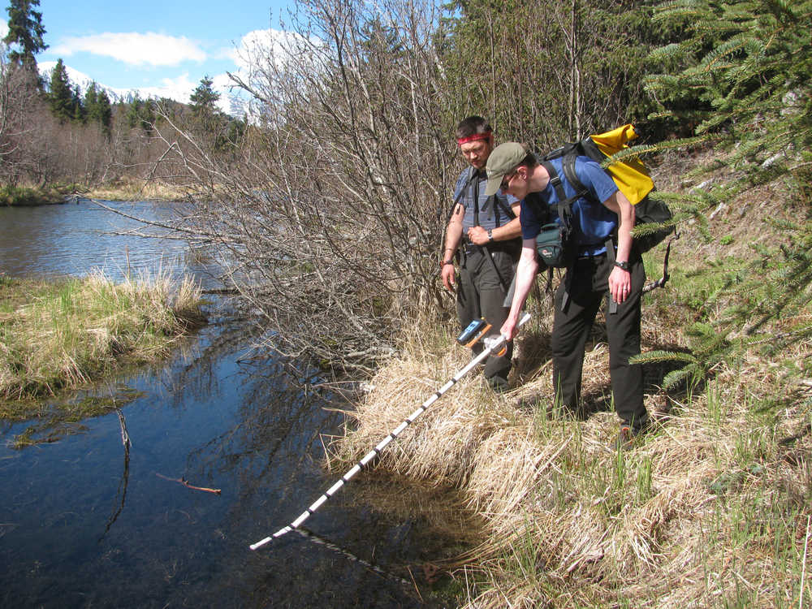

{width="800"}

In spring 2016 I had the pleasure of hiking to Upper Russian Lake with two of my good friends to install water temperature loggers as part of my graduate research project. Our local paper the Peninsula Clarion published this nice account about the journey and the larger project. (Peninsula Clarion, May 15, 2016 - [**Article Link**](https://www.peninsulaclarion.com/news/scientific-collaboration-connects-humans-salmon-on-the-kenai/)).

My two companions were the most helpful support one could have for hauling science gear out to a difficult and remote spot. [Erik Schoen](https://schoenlab.alaska.edu/people) is a research professor at University of Alaska Fairbanks, a member of my M.S. graduate committee, and all-around amazing person. [John Messick](https://johnlmessick.com/) is a local professor of English at Kenai Peninsula College, a journalist, and my former saw-partner when we worked as wildland firefighters long ago.

It was a special couple of days, and I'm grateful to have had such amazing company and that this article captured a snapshot.
